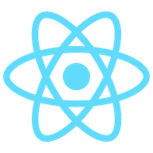

  

<h1 align="center">SubFinder</h1>

<em>Cerca una parola nei sottotitoli e salta al punto giusto in DaVinci Resolve.</em>

  
  
  
  

---

## Cos'è

**SubFinder** cerca una **parola nei sottotitoli** della timeline aperta e **sposta
la playhead** sul sottotitolo che la contiene. Se la parola compare più volte, due
freccette **◀ ▶** scorrono tra i risultati. È il "trova" che manca a chi monta
interviste e parlato: invece di scorrere a occhio decine di sottotitoli, scrivi la
parola e sei lì.

---

## Requisiti

- **DaVinci Resolve Studio** (lo scripting non è disponibile nella versione gratuita).
- Una timeline con una **traccia sottotitoli**.
- **Nessuna** dipendenza esterna: Python interno di Resolve.

---

## Installazione (il pannello dentro Resolve)

1. **Scarica** questo repository: **Code ▸ Download ZIP**, poi estrai.
2. Apri la cartella **degli script Utility** di Resolve:
   - **Windows:** `%APPDATA%\Blackmagic Design\DaVinci Resolve\Support\Fusion\Scripts\Utility`
   - **macOS:** `~/Library/Application Support/Blackmagic Design/DaVinci Resolve/Fusion/Scripts/Utility`
3. **Copia dentro quella cartella** due file presi da `resolve_scripts/`:
   - `SubFinder.py`
   - `plutonic_logo.png`  ← per il logo nel pannello.
4. **Avvia (o riavvia) DaVinci Resolve.**
5. Trovi il plugin in **Workspace ▸ Scripts ▸ Utility ▸ SubFinder**.

---

## Come si usa

1. Apri la timeline (con una **traccia sottotitoli**) → **Aggiorna** se serve.
2. Scrivi la **parola** e premi **Cerca** (o Invio).
3. La playhead salta al primo risultato; con **◀ ▶** scorri gli altri. Il contatore
   mostra `posizione / totale`. **Doppio click** su una riga per saltarci.
4. **Parola intera**: spunta per il match esatto (non "cat" dentro "category").

---

## Licenza

Software proprietario — © Matteo Congedo / Plutonic Studio. Tutti i diritti riservati.
Vedi [LICENSE](LICENSE).
