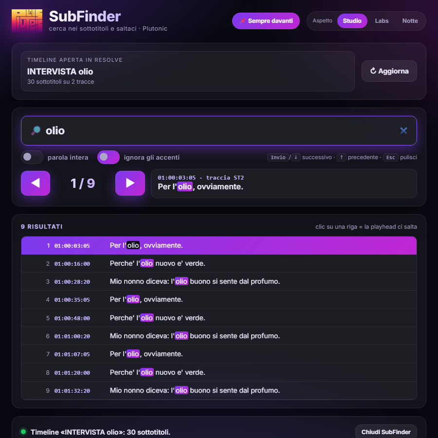
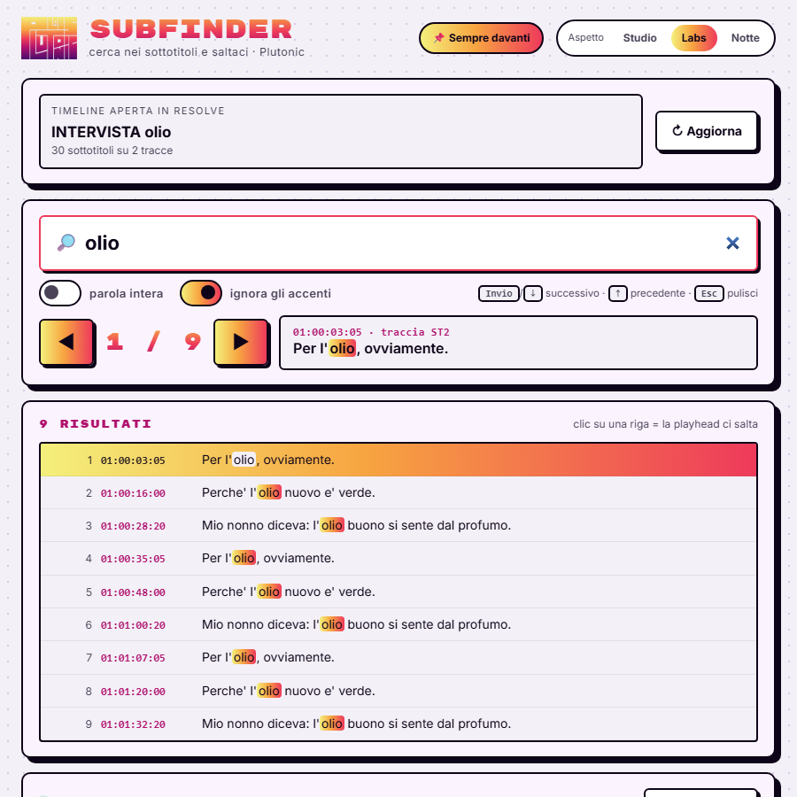
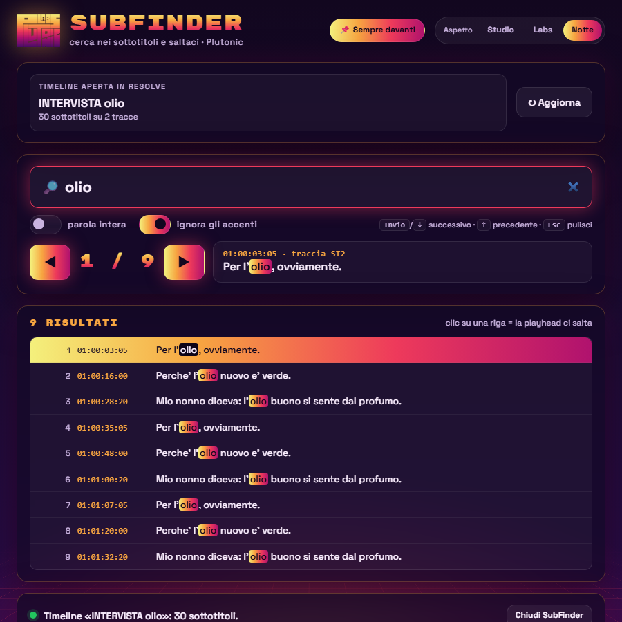

  

<h1 align="center">SubFinder</h1>

<em>Cerca una parola nei sottotitoli e salta al punto giusto in DaVinci Resolve.</em>

  
  
  
  

---

## Cos'è

**SubFinder** cerca una **parola nei sottotitoli** della timeline aperta e **sposta
la playhead** sul sottotitolo che la contiene. Se la parola compare più volte, due
freccette **◀ ▶** scorrono tra i risultati. È il "trova" che manca a chi monta
interviste e parlato: invece di scorrere a occhio decine di sottotitoli, scrivi la
parola e sei lì.

Si apre in una **finestra a parte** (Chrome o Edge in modalità app, col logo Plutonic
nella barra delle applicazioni), che può restare **sempre davanti** a Resolve.

| Studio | Labs | Notte |
|---|---|---|
|  |  |  |

---

## Requisiti

- **DaVinci Resolve Studio** (lo scripting non è disponibile nella versione gratuita).
- Una timeline con una **traccia sottotitoli**.
- **Google Chrome** o **Microsoft Edge** per la finestra (su Windows Edge c'è sempre;
  senza, si apre nel browser predefinito).
- **Nessuna** dipendenza esterna: Python interno di Resolve.

---

## Installazione (il pannello dentro Resolve)

1. **Scarica** questo repository: **Code ▸ Download ZIP**, poi estrai.
2. Apri la cartella **degli script Utility** di Resolve:
   - **Windows:** `%APPDATA%\Blackmagic Design\DaVinci Resolve\Support\Fusion\Scripts\Utility`
   - **macOS:** `~/Library/Application Support/Blackmagic Design/DaVinci Resolve/Fusion/Scripts/Utility`
3. **Copia dentro quella cartella** due file presi da `resolve_scripts/`:
   - `SubFinder.py`
   - `plutonic_logo.png`  ← per il logo nella finestra e nella barra delle applicazioni.
4. **Avvia (o riavvia) DaVinci Resolve.**
5. Trovi il plugin in **Workspace ▸ Scripts ▸ Utility ▸ SubFinder**.

---

## Come si usa

1. Apri in Resolve la timeline con una **traccia sottotitoli** e lancia SubFinder
   (**Workspace ▸ Scripts ▸ Utility ▸ SubFinder**). Se apri un'altra timeline la rilegge
   da sola; **↻ Aggiorna** (o tornare sulla finestra) rilegge i sottotitoli se li hai cambiati.
2. **Scrivi**: la ricerca è istantanea mentre scrivi e, dopo un attimo, la playhead
   salta al primo risultato. Le parole trovate sono evidenziate.
3. **Invio** o **↓** = risultato successivo, **↑** = precedente (o i pulsanti **◀ ▶**);
   il contatore mostra `posizione / totale`. **Clic su una riga** = la playhead ci salta.
   **Esc** svuota la ricerca e mostra **tutti** i sottotitoli.
4. Opzioni: **parola intera** (non trova "cat" dentro "category") e **ignora gli accenti**
   ("perche" trova anche "perché").

- **📌 Sempre davanti** (acceso di base): la finestra resta davanti a Resolve anche
  quando clicchi nella timeline.
- Tre aspetti: **Studio**, **Labs**, **Notte** (come BeaTonic e PlutoniCut).
- Gira solo sul tuo computer (un piccolo server su `127.0.0.1`); chiudendo la finestra
  il plugin si chiude da solo.

---

## Licenza

Software proprietario — © Matteo Congedo / Plutonic Studio. Tutti i diritti riservati.
Vedi [LICENSE](LICENSE).
